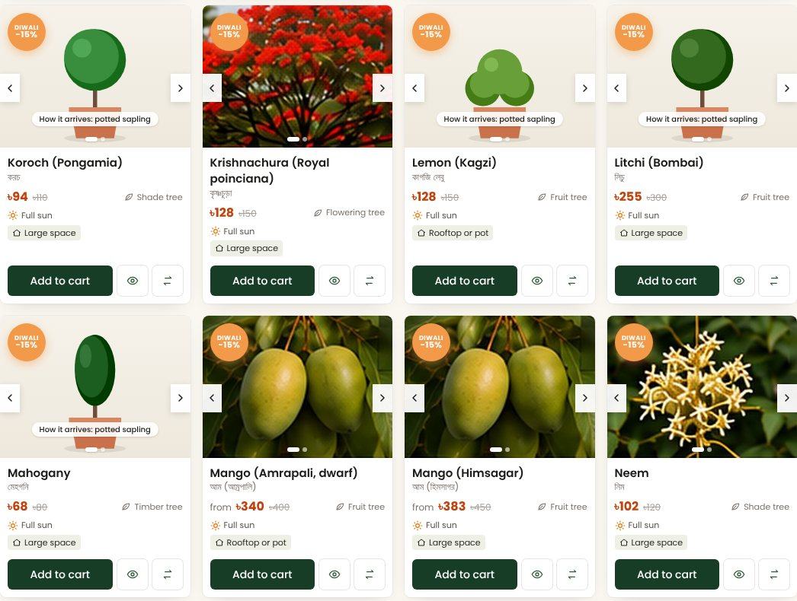
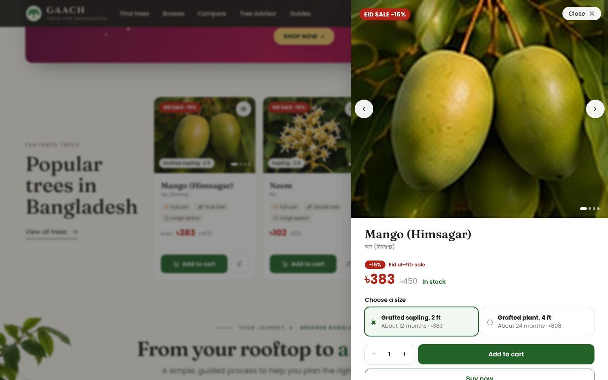
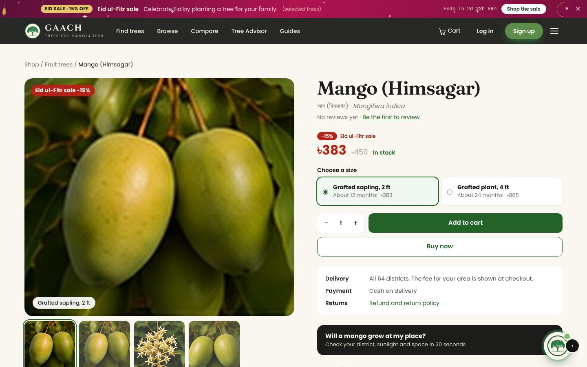
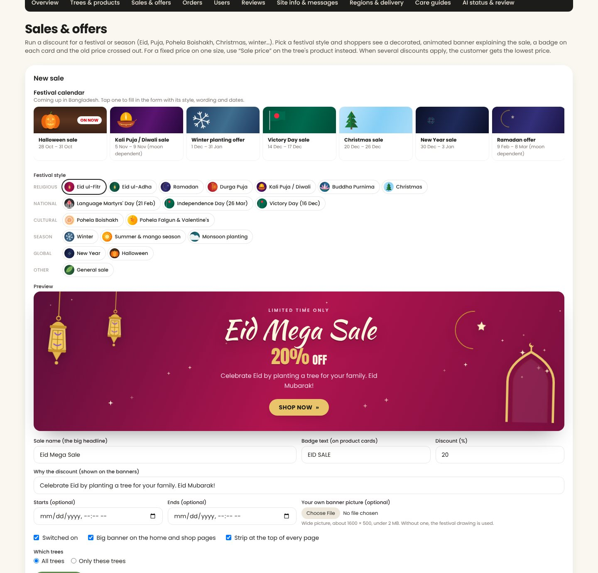
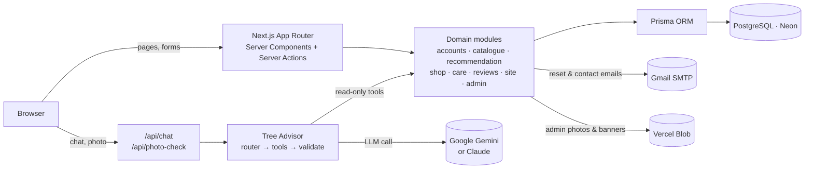
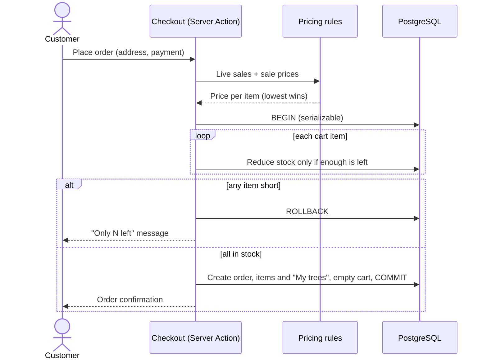
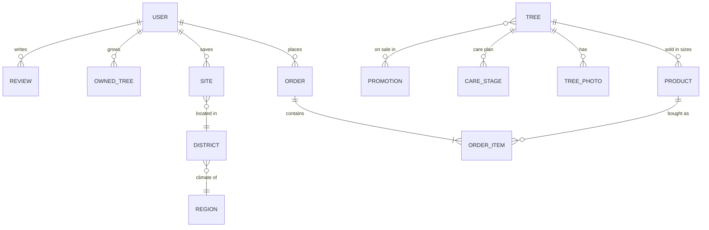
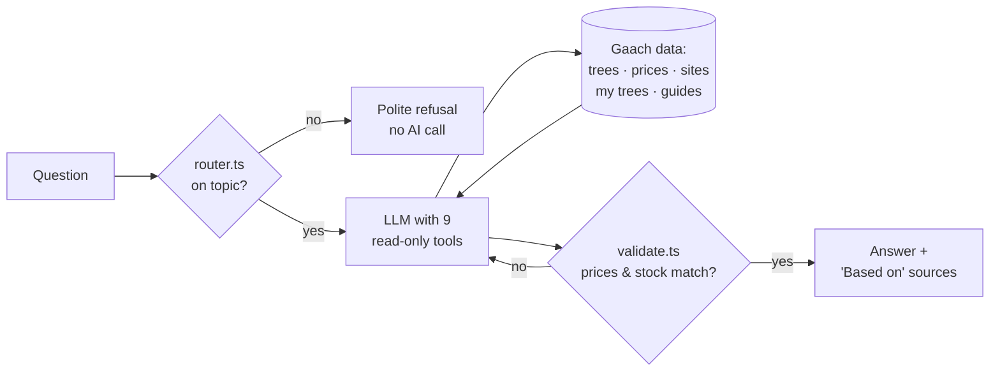

<a id="top"></a>

<div align="center">


# Gaach (গাছ)

### The right tree for the right place in Bangladesh

Gaach recommends trees that suit a user's district and planting spot, sells healthy saplings with cash on delivery,<br />
and helps after planting with care plans, an AI Tree Advisor and a photo check for sick plants.

**[🌐 Live site](https://gaach.vercel.app/)** &nbsp;·&nbsp; **[✨ Features](#features)** &nbsp;·&nbsp; **[🖼️ Screenshots](#screenshots)** &nbsp;·&nbsp; **[🚀 Getting started](#getting-started)** &nbsp;·&nbsp; **[✉️ Contact](#author-and-license)**


<br />


</div>

### At a glance

| 🌳 Tree species | 🗺️ Districts covered | 📚 Care guides | 🎉 Festival styles | 🤖 Advisor tools | ✅ Unit tests |
|:---:|:---:|:---:|:---:|:---:|:---:|
| **30** | **64** | **28** | **18** | **9** | **51** |

---

## Contents

<table>
<tr>
<td valign="top">

**The product**
- [Overview](#overview)
- [Highlights](#highlights)
- [Screenshots](#screenshots)
- [Features](#features)
- [Pages and routes](#pages-and-routes)

</td>
<td valign="top">

**How it works**
- [Tech stack](#tech-stack)
- [Architecture](#architecture)
- [Data model](#data-model)
- [Recommendation engine](#recommendation-engine)
- [Tree Advisor](#tree-advisor-ai-assistant)
- [Photo check](#photo-check-for-sick-plants)
- [Shop and pricing](#shop-and-pricing)
- [Festival sales](#festival-sales)

</td>
<td valign="top">

**Run it**
- [Getting started](#getting-started)
- [Environment variables](#environment-variables)
- [Email and password reset](#email-and-password-reset)
- [Admin access](#admin-access)
- [Deployment](#deployment)
- [Scripts](#scripts)
- [Project structure](#project-structure)

</td>
<td valign="top">

**Quality and more**
- [Testing](#testing-and-quality)
- [Security and privacy](#security-and-privacy)
- [Design system](#design-system)
- [Responsive and accessible](#responsive-layout-and-accessibility)
- [Troubleshooting](#troubleshooting)
- [Roadmap](#roadmap)
- [Credits](#credits)
- [Author and license](#author-and-license)

</td>
</tr>
</table>

---

## Overview

Many saplings planted in Bangladesh die in their first year. Usually the tree didn't suit the place: too much shade, salty soil in the coastal south, land that floods every monsoon, or a large tree squeezed into a rooftop drum.

**Gaach** (Bangla for *tree*) handles the whole journey in three steps:

| Step | What happens |
|---|---|
| **1. Recommend** | The user picks their division and district and describes the spot: space, sunlight, soil and purpose. Gaach matches trees to the district's rainfall, flooding, drought and salinity, and explains every pick. |
| **2. Buy** | The user orders healthy saplings in several sizes, with cash on delivery to all 64 districts, and festival discounts when a sale is on. |
| **3. Care** | After buying, the user gets a stage-by-stage care plan, an AI Tree Advisor that knows their own trees and sites, practical care guides, and a photo check for sick plants. |

Gaach was built for **CSE412 (Software Engineering) at East West University, Dhaka**, from a requirements specification of 61 functional and non-functional requirements.

<p align="right"><sub><a href="#top">↑ Back to top</a></sub></p>

## Highlights

- **Explainable recommendations.** Every match shows a score, a match level and a plain-language reason. If nothing fits, Gaach names the condition that ruled out the most trees and suggests how to relax it.
- **A grounded AI advisor.** The Tree Advisor answers only tree questions. It uses nine read-only tools over Gaach's own data, and checks that every price and stock figure in an answer matches the tool results.
- **Built for real shopping.** Photo sliders and a quick-view panel on every product, sale prices with the old price crossed out, and stock reserved in a single database transaction so two people can't buy the last sapling at once.
- **Festival-ready.** 18 hand-drawn, animated festival styles and a Bangladesh festival calendar let the admin launch an Eid, Puja, Boishakh or Victory Day sale in a minute.
- **Polished, responsive design.** A charcoal, warm white and natural green palette, careful animations that respect "reduce motion", and layouts that work from a 360 px phone up to a zoomed-out 4K screen.
- **Free to run.** Vercel Hobby, a Neon free database, the Gemini free tier and Gmail SMTP.

<p align="right"><sub><a href="#top">↑ Back to top</a></sub></p>

## Screenshots

### Plan

| Find trees for your place | Browse the catalogue |
|---|---|
|  |  |
| **Compare trees side by side** | **Tree Advisor** |
|  |  |

### Shop

| Product cards with photo arrows and sale badges | Quick view from the eye button |
|---|---|
|  |  |
| **Tree page with sizes and sale price** | **From your rooftop to a growing tree** |
|  |  |

### Festival sales


| Admin: festival calendar, style picker and live preview | Planting and care guides |
|---|---|
|  |  |

### On a phone

<p align="center">
  
  &nbsp;&nbsp;
  
</p>

<p align="right"><sub><a href="#top">↑ Back to top</a></sub></p>

## Features

### For visitors and customers

| Feature | Description |
|---|---|
| 🌳 **Tree finder** | Recommends trees for a district and spot. Photo cards show the match score, the reasons and Buy and Compare buttons. Condition chips on the page update with the user's choices. |
| 🔎 **Browse and search** | Every tree, with filters for type, sunlight, soil, mature size, price and "On sale only". Search works in English, in Bangla and by scientific name. Grid and list views, sorting and star ratings are included. |
| 🖼️ **Product cards** | One card design on the home, Browse and tree pages. Round arrows (shown on hover, always on phones) or a swipe flip through the photos and the potted sapling it arrives as. A size tag on the photo, a red sale label, the sale price with the old price crossed out, and the same green **Add to cart** button on every card. For a tree with several sizes, Add to cart opens the quick view so the shopper picks a size first. |
| 👁️ **Quick view** | The eye button on the photo opens a side panel (a bottom sheet on phones) with a large photo slider, sizes, quantity, Add to cart, Buy now and a short description. |
| ⚖️ **Compare** | Put 2 or 3 trees side by side: size, growth rate, sunlight, soil, water, season, flood, drought and salt tolerance, and cautions. |
| 🎉 **Festival sales** | A decorated, animated banner on the home and shop pages and a strip with a countdown on every page, explaining the occasion and why prices are lower. |
| 📅 **Planting season** | Every tree has its best planting months for Bangladesh (most trees: June to September, early in the monsoon). Cards show "Plant now" or the best months, and the tree page explains what to do if you buy outside them. |
| 🌲 **Sizes up to a large plant** | Each tree comes in its sapling sizes plus a **Large plant, 6-8 ft** (about 3 years old). The tree page also shows a drawing of the tree when fully grown, with its mature height. |
| 🛒 **Cart and checkout** | Several sizes per tree, quantity steppers, "Sale savings" in the summary, a stock-safe checkout, cash on delivery and a flat delivery fee. |
| 📦 **Orders and My trees** | Order history, plus a "My trees" page that shows each tree's current growth stage and what to do next. |
| 🤖 **Tree Advisor** | An AI chat that answers tree questions using Gaach's data and the user's own trees and saved sites. It is on every page and as a full page at `/assistant` with chat history. **New chat** always starts a clean chat, and a refresh keeps the current one. |
| 📷 **Photo check** | Send a photo of a sick plant and get the likely problem, safe next steps and links to care guides. |
| 📚 **Care guides** | 28 practical guides grouped into planting and care, pests, problems and diseases, site and weather, safety, and specific trees. |
| ⭐ **Ratings and reviews** | 1 to 5 stars with comments, and a "Bought from Gaach" badge for verified buyers. |
| 🎬 **"Why Trees Matter" film** | A 60-second film with captions, opened from the home page hero. |
| 🔑 **Accounts** | Register, log in, a show/hide eye on every password box, saved sites, and a self-service password reset by email. |
| 📬 **Contact and newsletter** | A contact form and a newsletter sign-up, both protected by a hidden bot trap and rate limits. |
| 📱 **Installable** | Works as a Progressive Web App on phones. |

### For the administrator

| Area | Capabilities |
|---|---|
| **Trees and products** | Add, edit and publish trees. Upload several photos per tree at once and reorder or delete them. Manage sizes, prices, sale prices, stock, care stages and each tree's best planting months. |
| **Sales and offers** | A Bangladesh festival calendar fills in a sale in one tap. Pick one of 18 festival styles (with a live preview) or upload your own banner picture, then set the headline, badge, percent off, the reason shown to shoppers, dates, and all trees or chosen trees. Each sale shows as Live, Starts in N days, Ended or Off, and a scheduled sale has a **Start now** button. |
| **Orders** | View all orders and update their status. Cancelling an order returns its stock. |
| **Users and email** | View accounts, send a test email, email a reset link to a user, and see the last emails the site tried to send, with the result of each. |
| **Reviews** | Hide, show or delete reviews. |
| **Site info and messages** | Edit the hotline, nursery addresses, email and social links shown in the footer. Read contact messages and newsletter sign-ups. |
| **Regions and delivery** | Edit regional climate profiles, assign districts to regions, and set the delivery fee. |
| **Care guides** | Review guides and mark them as checked. |
| **AI status and review** | Test the AI connection, and see refused questions with their reasons, plus tool usage. |

<p align="right"><sub><a href="#top">↑ Back to top</a></sub></p>

## Pages and routes

<details>
<summary><b>Show all routes</b></summary>

| Page | Route |
|---|---|
| Home | `/` |
| Find trees for my place | `/recommend` |
| Browse all trees | `/trees` |
| Tree details, sizes and reviews | `/trees/[slug]` |
| Compare | `/compare` |
| Tree Advisor | `/assistant` (plus a chat button on every page) |
| Care guides, one guide | `/guides`, `/guides/[slug]` |
| Cart, checkout | `/cart`, `/checkout` |
| My orders, My trees | `/orders`, `/my-trees` |
| Account and saved sites | `/account` |
| Log in, register, forgot and reset password | `/login`, `/register`, `/forgot-password`, `/reset-password` |
| About, contact | `/about`, `/contact` |
| Policies | `/privacy`, `/terms`, `/refund-policy`, `/community-guidelines` |
| Photo credits | `/credits` |
| Admin dashboard | `/admin` |
| API | `/api/chat`, `/api/photo-check` |

</details>

<p align="right"><sub><a href="#top">↑ Back to top</a></sub></p>

## Tech stack

| Layer | Technology |
|---|---|
| Framework | **Next.js 15** (App Router, Server Components, Server Actions) |
| Language | **TypeScript** (strict) |
| UI | **React 19**, **Tailwind CSS 4**, hand-written CSS animations and inline SVG illustrations |
| Database | **PostgreSQL** (Neon, free tier) |
| ORM | **Prisma 6** |
| Validation | **Zod** on every form and API input |
| Authentication | Email and password, **bcrypt** hashing, database sessions with an idle timeout |
| AI | **Google Gemini** (free tier, with automatic model fallback); **Claude** (Anthropic) also supported |
| Email | **Nodemailer** through Gmail SMTP |
| File storage | **Vercel Blob** online, a local `uploads/` folder in development |
| Hosting | **Vercel** (Hobby plan, Singapore region) |
| Testing | Node's built-in test runner (`node:test`) with `tsx`, and Playwright for browser checks |

<p align="right"><sub><a href="#top">↑ Back to top</a></sub></p>

## Architecture



- **Pages** are Server Components that read data directly through Prisma. **Mutations** (cart, checkout, reviews, admin edits) are Server Actions that validate input with Zod and check the user's role on the server.
- **Business logic** lives in `src/modules/*`, separate from the UI, so it can be unit-tested and reused, for example by the Advisor's tools.
- **One pricing rule** (`src/modules/shop/price-rules.ts`) is shared by product cards, the cart, checkout, the saved order and the Advisor, so a customer never sees one price and pays another.
- **The Tree Advisor** never writes data. Its tools are read-only, and the user's identity always comes from the session, never from the chat message.

### Placing an order



<p align="right"><sub><a href="#top">↑ Back to top</a></sub></p>

## Data model

The Prisma schema (`prisma/schema.prisma`) has 25 models. The core of the shop looks like this:



| Group | Models |
|---|---|
| Accounts | `User`, `Session`, `PasswordReset`, `Site` (saved planting spots) |
| Geography and climate | `Division`, `District`, `Region` (rainfall, flood, drought and salinity profile) |
| Catalogue and care | `Tree`, `TreePhoto` (extra photos), `Product` (sizes, prices, sale prices, stock), `CareStage`, `CareGuide` |
| Shop | `CartItem`, `Order`, `OrderItem`, `OwnedTree` (a bought tree with its planted date), `Promotion` (festival sales) |
| Community | `Review`, `Subscriber`, `ContactMessage` |
| Advisor and operations | `Conversation`, `ChatMessage`, `RefusedQuestion`, `EmailLog`, `Setting` |

The starting data in `prisma/data/` covers 30 tree species, all 8 divisions and 64 districts mapped to regional climate profiles, the care stages for each tree, and the care guides.

<p align="right"><sub><a href="#top">↑ Back to top</a></sub></p>

## Recommendation engine

Code: `src/modules/recommendation/`

1. **Region.** The district maps to a regional profile: rainfall, flooding, drought and salty soil. Admins can edit these profiles.
2. **Filter.** Trees are removed if they can't survive the region, are wider than the space available, or don't tolerate the sunlight.
3. **Score.** The remaining trees are scored on soil, purpose, regional strengths, room to spare, preferred sunlight and planting season. The finder asks "When will you plant? Now / Next monsoon" and favours trees whose best planting months match; the rest get a note on when to plant. The weights are in `weights.ts`, so they're easy to tune.
4. **Explain.** Each result gets a match level and a plain-language reason. If nothing qualifies, the page names the condition that removed the most trees and suggests how to relax it.

Ties are broken by name and id, so the same inputs always give the same ranking.

<p align="right"><sub><a href="#top">↑ Back to top</a></sub></p>

## Tree Advisor (AI assistant)

Code: `src/modules/assistant/`

The Advisor is the round button in the bottom-right corner of every page. The full chat with history is at `/assistant`. On a tree page, it already knows which tree you mean.

It answers **tree questions only**: what to plant in a season ("which tree for summer?", "what can I plant now?", answered straight from each tree's planting months, no site details needed), why a tree was recommended, planting and care, plant problems, comparisons, products and prices (including live sale prices), and help with the trees the user bought. It never places orders, changes accounts or invents trees.



**How an answer is made:**

1. `router.ts` sorts the question by intent and refuses off-topic, manipulative or privacy-breaking questions **before** any AI call.
2. `tools.ts` gives the AI nine **read-only** tools: catalogue search, tree details, recommendations, compare, product price and stock, the user's saved sites, the user's trees, care plans, and guide search. The user always comes from the login session, never from the question.
3. `retrieval.ts` searches the care guides (English and Bangla word matching). Answers show their sources as "Based on" chips.
4. For plant problems, it asks one question at a time before suggesting causes.
5. `validate.ts` checks every answer. Prices and stock must match this turn's tool results, or the AI is asked to correct itself.

**Reliability.** Free Gemini models are sometimes busy. The site tries `gemini-3.5-flash`, then `gemini-3.8-flash`, then `gemini-3.5-flash-lite`, skips any model that was busy in the last 3 minutes, and after 50 seconds answers from Gaach's own data instead. **Admin → AI status & review** shows the exact problem if the AI isn't working.

<p align="right"><sub><a href="#top">↑ Back to top</a></sub></p>

## Photo check for sick plants

Code: `src/modules/assistant/photo.ts`, `src/app/api/photo-check/route.ts`

In the Advisor chat, the 📷 button lets a user send a photo, with an optional note such as "lemon, leaves yellowing". The reply gives the most likely problem and how sure it is, other possibilities, safe next steps and things to avoid, and links to Gaach's own care guides.

Blurry photos get a request for a better photo instead of a guess. The photo is shrunk in the browser before upload and is **never stored**; only the text answer is saved. Users are limited to 5 checks per minute.

<p align="right"><sub><a href="#top">↑ Back to top</a></sub></p>

## Shop and pricing

- **Checkout.** Stock is checked and reduced in a single database transaction, so two people can't buy the last sapling at once. Payment is cash on delivery. A test-mode online gateway is included for demonstration.
- **Delivery.** One flat fee for all 64 districts, set by the admin.
- **Reviews.** One review per user per tree. Verified buyers get a "Bought from Gaach" badge. Admins can hide reviews that break the community guidelines.
- **Footer details.** The hotline, nursery addresses, email and social links are edited in **Admin → Site info & messages**. Empty fields are hidden, so no placeholder contact details ever appear.

**How a price is worked out.** Each size has a normal price and an optional fixed sale price. A live festival sale takes a percentage off the normal price (capped at 90%). The customer always pays the **lowest** of these, and the normal price is shown crossed out.

| Size | Normal price | Sale price set by admin | Live sale | Customer pays |
|---|---:|---:|---|---:|
| Mango, 2 ft | ৳450 | — | Diwali 15% off | **৳383** ~~৳450~~ |
| Guava, 2 ft | ৳200 | ৳160 | Diwali 15% off (৳170) | **৳160** ~~৳200~~ |
| Neem, 2 ft | ৳120 | — | none | **৳120** |

The same rule is used everywhere a price appears, and the order stores the price the customer actually paid. Seven unit tests cover it (`tests/pricing.test.ts`).

<p align="right"><sub><a href="#top">↑ Back to top</a></sub></p>

## Festival sales

Code: `src/lib/festivals.ts`, `src/components/festival/`, `src/app/admin/sales/`

Admins create sales in **Admin → Sales & offers**. Each sale has a headline, a badge for product cards, a percent off, the reason shown to shoppers, optional start and end dates, and either all trees or chosen trees.

- **18 festival styles**, each with its own colours, lettering and hand-drawn SVG decorations that move gently: lanterns swing, diyas flicker, snow and petals fall, bats fly and flags wave. No stock images are used, so there are no licensing worries.

  | Religious | National | Cultural | Seasons | Global |
  |---|---|---|---|---|
  | Eid ul-Fitr · Eid ul-Adha · Ramadan · Durga Puja · Kali Puja / Diwali · Buddha Purnima · Christmas | Ekushe February (21 Feb) · Independence Day (26 Mar) · Victory Day (16 Dec) | Pohela Boishakh · Pohela Falgun & Valentine's | Winter · Summer & mango season · Monsoon planting | New Year · Halloween |

- **Festival calendar.** The admin page lists the festivals coming up in Bangladesh. One tap fills in the style, wording, discount and dates. Dates for Eid, Puja and Buddha Purnima depend on the moon and are marked so.
- **Your own picture.** Instead of a drawn style, the admin can upload a banner picture, with or without Gaach's text on top.
- **Where shoppers see it.** A big banner on the home and Browse pages, a strip with a live countdown at the top of every page, a red sale label on product cards and the sale name next to the price.
- **Scheduled sales.** A sale with a future start date changes nothing until that moment. The admin list says how many days are left, and **Start now** begins it straight away. Leave the start date empty to begin immediately.

<p align="right"><sub><a href="#top">↑ Back to top</a></sub></p>

## Getting started

### Prerequisites

- **Node.js 20 or newer** (check with `node -v`)
- A **PostgreSQL** database. The easiest free option is [Neon](https://neon.tech). A local PostgreSQL works too.

### Install and run

```bash
# 1. Clone and install
git clone https://github.com/mohammednaeemog-sys/gaach.git
cd gaach
npm install

# 2. Create your settings file
cp .env.example .env        # Windows PowerShell: Copy-Item .env.example .env
#    then open .env and set DATABASE_URL

# 3. Create the tables and load trees, districts and guides
npm run setup

# 4. Start the development server
npm run dev
```

Open **http://localhost:3000**.

`npm run setup` is safe to repeat and never deletes data. To wipe the database and start again, use `npm run db:reset`.

### Demo account (local development)

| Role | Email | Password |
|---|---|---|
| User | `user@gaach.test` | `User1234` |

The demo user has two saved sites and a delivered lemon tree, so "My trees" and personal Advisor questions work straight away. Locally, if `ADMIN_EMAIL` is not set, a demo admin is created for testing. Online, the demo admin is always locked (see [Admin access](#admin-access)).

<p align="right"><sub><a href="#top">↑ Back to top</a></sub></p>

## Environment variables

Copy `.env.example` to `.env`. **Never commit `.env`**; it is already listed in `.gitignore`.

<details>
<summary><b>Show all variables</b></summary>

| Variable | Needed | Purpose |
|---|---|---|
| `DATABASE_URL` | ✅ Always | PostgreSQL connection string (`postgresql://...`). |
| `ADMIN_EMAIL` | Online | Email address of the owner's admin account. |
| `ADMIN_PASSWORD` | Online | Password for that admin account. |
| `GEMINI_API_KEY` | Optional | Turns on the AI Tree Advisor and photo check. Free at [aistudio.google.com/apikey](https://aistudio.google.com/apikey). |
| `GEMINI_MODEL` | Optional | Forces one Gemini model instead of the automatic fallback list. |
| `ANTHROPIC_API_KEY` | Optional | Uses Claude instead of Gemini (paid). |
| `AI_PROVIDER` | Optional | `gemini` or `claude`, when both keys are set. |
| `SMTP_USER` | Optional | Gmail address that sends reset and contact emails. Gaach uses `gaach.company@gmail.com`. |
| `SMTP_PASS` | Optional | The 16-letter Gmail **App password**, never the account password. |
| `SMTP_HOST`, `SMTP_PORT` | Optional | Another SMTP server. Defaults to Gmail on port 465, with 587 as a fallback. |
| `MAIL_FROM` | Optional | Sender name and address, e.g. `Gaach <gaach.company@gmail.com>`. Defaults to `Gaach <SMTP_USER>`. |
| `APP_URL` | Optional | The public site address used in email links. |
| `BLOB_READ_WRITE_TOKEN` | Online | Added by Vercel when a Blob store is connected; stores admin photo uploads. |

</details>

Without a Gemini key, the site still works: the Advisor answers from Gaach's own data. Without email settings, the forgot-password page explains that email isn't available, and reset links are printed in the server log.

<p align="right"><sub><a href="#top">↑ Back to top</a></sub></p>

## Email and password reset

When someone uses **Forgot password**, Gaach emails them a one-time reset link straight away. Only the person who can open that inbox can use it. The link expires after 30 minutes, and a user can request at most 3 links per hour. Resetting the password signs the user out on every device, and the owner gets a "your password was changed" email.

**Setting up Gmail (free):**

1. Turn on **2-Step Verification** for the Google account that will send the emails.
2. Create an **App password** at [myaccount.google.com/apppasswords](https://myaccount.google.com/apppasswords).
3. In Vercel → Settings → Environment Variables, set `SMTP_USER` to the Gmail address and `SMTP_PASS` to the App password. Mark both as secret.
4. Redeploy. Vercel only applies new variables to new deployments.

Every attempt is logged. **Admin → Users → Recent emails** shows each message's recipient, time and result, including the error if Gmail refused it.

<p align="right"><sub><a href="#top">↑ Back to top</a></sub></p>

## Admin access

The admin login is **never stored in the code or the repository**. It is set privately through the `ADMIN_EMAIL` and `ADMIN_PASSWORD` environment variables.

On every build, `scripts/seed-if-empty.ts`:

1. creates the admin account from those variables if it doesn't exist, or makes sure it is an admin with that password;
2. locks the public demo admin (`admin@gaach.test`) by turning it into a normal user with a random password;
3. applies one-time data updates from `scripts/data-updates.ts`, such as adding the Large plant size to every tree. Each update runs once per database, so later admin edits are kept.

To change the admin password, edit `ADMIN_PASSWORD` in Vercel and redeploy.

<p align="right"><sub><a href="#top">↑ Back to top</a></sub></p>

## Deployment

The live site runs on **Vercel** (free Hobby plan) with a **Neon** PostgreSQL database and **Vercel Blob** for photos. The full step-by-step guide is in **[DEPLOY.md](DEPLOY.md)**.

1. Create a Vercel project and link it: `npx vercel@latest link`.
2. In Vercel → Storage, connect a **Neon** database (prefix `DATABASE`) and a **public Blob store**.
3. Add `ADMIN_EMAIL`, `ADMIN_PASSWORD`, `GEMINI_API_KEY`, `SMTP_USER` and `SMTP_PASS` as environment variables.
4. Deploy with `npx vercel@latest --prod`, or connect this GitHub repository so every push deploys automatically.

The build command (`npm run build`) syncs the database schema, loads starting data into an empty database, sets up the admin account, and then builds the site. It never overwrites existing data, so new tables (like photos and sales) are added safely on the next deploy.

<p align="right"><sub><a href="#top">↑ Back to top</a></sub></p>

## Scripts

| Command | Description |
|---|---|
| `npm run dev` | Start the development server at http://localhost:3000 |
| `npm run setup` | Create the tables and fill an empty database (safe to repeat) |
| `npm run build` | Sync the database, set up first-time data and the admin, then build |
| `npm start` | Run the production build |
| `npm test` | Run the unit tests |
| `npm run typecheck` | Check TypeScript types |
| `npm run eval` | Run the Tree Advisor evaluation (add `-- --ai` to use the live AI) |
| `npm run db:reset` | ⚠️ Delete everything and reload the starting data |
| `npm run photos` | Download openly licensed tree photos from Wikimedia Commons |
| `npm run logo` | Redraw the logo files |

<p align="right"><sub><a href="#top">↑ Back to top</a></sub></p>

## Project structure

<details>
<summary><b>Show the folder tree</b></summary>

```
gaach/
├── prisma/
│   ├── schema.prisma          database tables
│   ├── seed.ts                starting data
│   └── data/                  trees, districts and regions, care stages, care guides
├── public/                    logo, photos, icons
├── scripts/
│   ├── seed-if-empty.ts       runs on every build: first-time data and admin setup
│   ├── data-updates.ts        one-time data changes, applied once per database
│   ├── eval-assistant.ts      Tree Advisor evaluation
│   ├── fetch-tree-photos.ts   downloads openly licensed tree photos
│   └── make-logo.mjs          draws the logo
├── src/
│   ├── app/                   pages and API routes (Next.js App Router)
│   ├── components/            UI components (Header, Footer, Chat, TreeCard, forms...)
│   ├── lib/                   database client, email, formatting, helpers
│   └── modules/
│       ├── accounts/          register, login, sessions, profile, password reset
│       ├── catalogue/         browse, search, filters, compare
│       ├── recommendation/    matching engine and weights
│       ├── shop/              cart, checkout, orders, payment
│       ├── care/              care stages and planted dates
│       ├── assistant/         Tree Advisor, AI providers, tools, photo check
│       ├── reviews/           ratings and comments
│       ├── site/              footer details, contact form, newsletter
│       └── admin/             admin actions and uploads
├── tests/                     unit tests
├── docs/                      screenshots and the film notes
├── DEPLOY.md                  free hosting guide
└── vercel.json                Vercel settings (Next.js, Singapore region)
```

</details>

<p align="right"><sub><a href="#top">↑ Back to top</a></sub></p>

## Testing and quality

| Check | Command | Result |
|---|---|---|
| Unit tests | `npm test` | **51 passing**: recommendation engine, pricing and discounts, care stages, password hashing, reset tokens, Advisor routing, tools and AI fallback, photo-check parsing and photo picking |
| Advisor evaluation | `npm run eval` | **140/140** scripted conversations and **30/30** guide-search checks (offline). Report: `evals/REPORT-offline.md` |
| Type safety | `npm run typecheck` | No errors (TypeScript strict) |
| Browser checks | Playwright scripts | Cart, checkout (charges the sale price), reviews, photo check, login and password eye, admin photo upload and sales, contact and newsletter forms |
| Layout | Playwright scripts | No sideways scrolling on any main page at 360, 390, 768, 1024, 1100, 1280, 1440 and 1920 px |

<details>
<summary><b>Requirement coverage</b></summary>

| Area | Where |
|---|---|
| FR-1 Accounts and access | `/register`, `/login`, `/account`, `/forgot-password`; role checks in `modules/accounts/session.ts` |
| FR-2 Location and conditions | `/recommend` form (division and district dropdowns, validated inputs), saved sites |
| FR-3 Recommendation | `modules/recommendation`, reasons, no-match advice, refine via URL |
| FR-4 Information and comparison | `/trees`, `/trees/[slug]`, `/compare` |
| FR-5 E-commerce | `/cart`, `/checkout`, `/orders`; cash on delivery and test gateway; stock-safe transaction |
| FR-6 Post-purchase care | `/my-trees` with current stage and full plan; problem help through the Advisor |
| FR-7 AI assistant | `/assistant`, `modules/assistant`; fixed refusals, personal context, grounded answers, memory |
| FR-8 Administration | `/admin`: trees, products, care content, regions, delivery fee, orders, users, reviews, site info, AI review |

</details>

<p align="right"><sub><a href="#top">↑ Back to top</a></sub></p>

## Security and privacy

- No passwords, API keys or private credentials are stored in the repository. All secrets live in environment variables, marked as secret in Vercel.
- Passwords are hashed with bcrypt. Reset tokens are stored only as SHA-256 hashes, expire after 30 minutes, are limited to 3 per hour, and the owner is emailed after a change.
- Every admin page and action checks the admin role on the server.
- All input is validated on the server with Zod. Uploaded pictures are checked for their real file type and size. The contact and newsletter forms have a hidden bot trap and rate limits.
- Prices are always worked out on the server at checkout, never taken from the browser.
- Plant photos sent for a check are never stored.
- Redirects only go to paths on this site.

<p align="right"><sub><a href="#top">↑ Back to top</a></sub></p>

## Design system

| Token | Value | Use |
|---|---|---|
| Charcoal | `#1c1d1a` | Header, hero overlays, primary text |
| Warm white | `#f6f2ea` | Page background, text on dark |
| Natural green | `#5e8c4a` | Accents and highlights |
| Deep green | `#183d27` | Primary buttons, active tabs, step numbers |
| Footer green | `#0f2a1d` | Footer background |
| Sale orange | `#f2994a` | Sale badges and discount labels |

- **Type.** Fraunces for headings, Poppins for body text, Cinzel for the wordmark, and Noto Serif Bengali for Bangla names. Festival banners add Kaushan Script, Anton and Creepster.
- **Photography and illustration.** Real tree photos on cards, and a drawn potted sapling and fully grown tree for species without a photo yet. Festival decorations are inline SVG.
- **Motion.** Headlines rise in line by line, hero photos cross-fade every 4 seconds, chips pop in and drift, cards lift on hover, and festival decorations swing, flicker and fall.
- **Restraint.** Every animation is turned off for people who set "reduce motion" in their system settings.

<p align="right"><sub><a href="#top">↑ Back to top</a></sub></p>

## Responsive layout and accessibility

- **Mobile first.** Layouts are checked at 360, 390, 768, 1024, 1100, 1280, 1440 and 1920 px wide. Cards adapt to their own width (the compare button hides on very narrow cards), photo sliders swipe on touch, and the quick view becomes a bottom sheet.
- **Wide and zoomed-out screens.** From 1536 px up, the root font size grows with the screen width (`font-size: calc(100vw / 96)`), and every size is set in `rem`, so the whole layout scales together up to a 4K monitor.
- **Accessibility.** Semantic HTML, a label on every form field and visible focus states. Photo arrows and the quick view have screen-reader labels, the quick view closes with Esc, the film has captions, and live regions announce Advisor replies.

<p align="right"><sub><a href="#top">↑ Back to top</a></sub></p>

## Troubleshooting

| Problem | Fix |
|---|---|
| `P1001: Can't reach database server` | Check `DATABASE_URL`. Locally, make sure PostgreSQL is running. |
| Reset emails don't arrive | Use a Gmail **App password** (not the account password) in `SMTP_PASS`, redeploy, then check **Admin → Users → Recent emails** for the exact error. |
| The Advisor answers without AI | Set `GEMINI_API_KEY`. **Admin → AI status & review** shows whether the key works and which model answered. |
| Photo or banner uploads fail online | Connect a public **Blob store** in Vercel → Storage, then redeploy. |
| A sale doesn't show | Its status in Admin → Sales & offers must read **Live**. "Starts in N days" means the start date is in the future: press **Start now** or clear the start date. Also check it is **Switched on** and, for "Only these trees", that the right trees are ticked. |
| New environment variables have no effect | Redeploy. Vercel applies variables only to new deployments. |
| `git commit` opens a Vim screen | Press `Esc`, type `:q!` and press Enter, then commit with `git commit -m "your message"`. To use Notepad instead, run `git config --global core.editor notepad`. |

<p align="right"><sub><a href="#top">↑ Back to top</a></sub></p>

## Roadmap

- [x] Recommendation engine with explanations
- [x] Shop with stock-safe checkout
- [x] AI Tree Advisor and photo check
- [x] Product photo sliders and quick view
- [x] Festival sales with a Bangladesh calendar
- [ ] Expert review of every care guide
- [ ] Bangla interface and Bangla offline Advisor answers
- [ ] Real online payments (bKash, Nagad or SSLCommerz) in place of the test gateway
- [ ] Order tracking with courier updates
- [ ] Native Android and iOS apps (Capacitor or Expo) that reuse the same server

<p align="right"><sub><a href="#top">↑ Back to top</a></sub></p>

## Credits

- Tree photos are credited on the [photo credits](https://gaach.vercel.app/credits) page under their open licenses.
- The "Why Trees Matter" film uses royalty-free footage from Pixabay; the notes are in [`docs/why-trees-matter-film.md`](docs/why-trees-matter-film.md).
- Festival decorations and the sapling drawings are original SVG artwork made for Gaach.
- Fonts (Fraunces, Poppins, Cinzel, Noto Serif Bengali, Kaushan Script, Anton, Creepster) are used under the SIL Open Font License.
- Festival dates are checked against [Office Holidays](https://www.officeholidays.com/countries/bangladesh/2027) and the Bangladesh government holiday list.

## Author and license

<table>
<tr>
<td>

**Mohammed Naeem**
<br />
Computer Science and Engineering, East West University, Dhaka<br />
Designer, developer and administrator of Gaach

- GitHub: [@mohammednaeemog-sys](https://github.com/mohammednaeemog-sys)
- Email: [mohammed.naeem.og@gmail.com](mailto:mohammed.naeem.og@gmail.com)
- Live site: [gaach.vercel.app](https://gaach.vercel.app/)

</td>
</tr>
</table>

This repository does not include an open-source license yet, so all rights are reserved by the author. Please get in touch before reusing the code or content.

<div align="center">

<br />

🌱 *Plant the right tree in the right place.*

<sub><a href="#top">↑ Back to top</a></sub>

</div>
