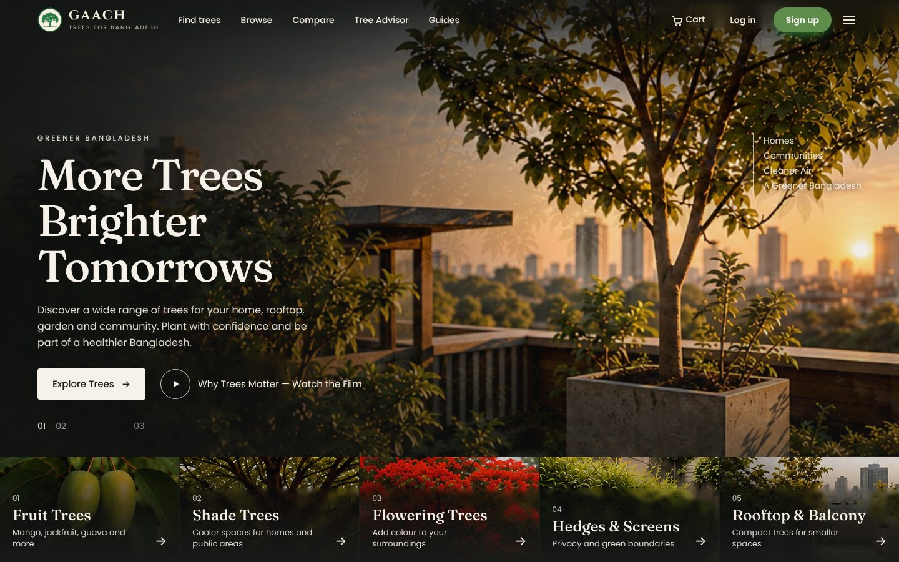
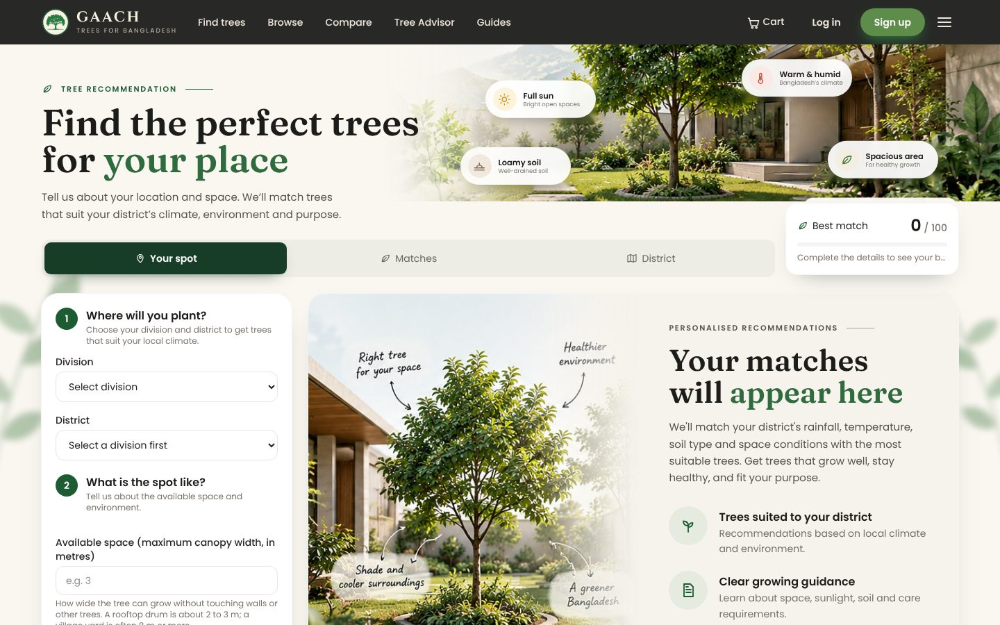
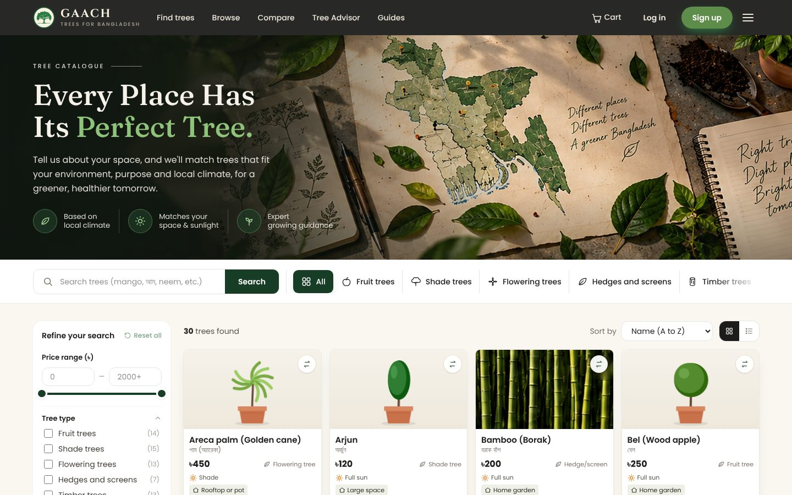
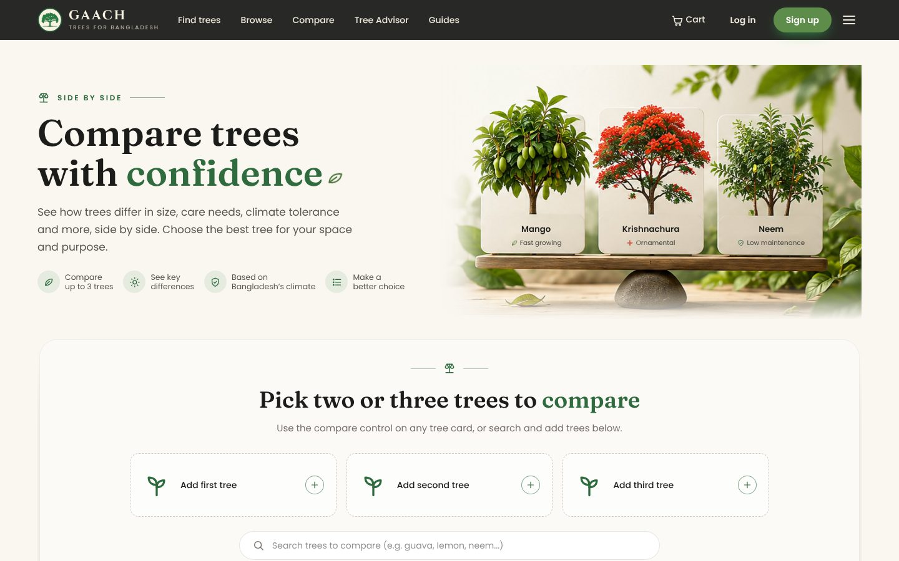
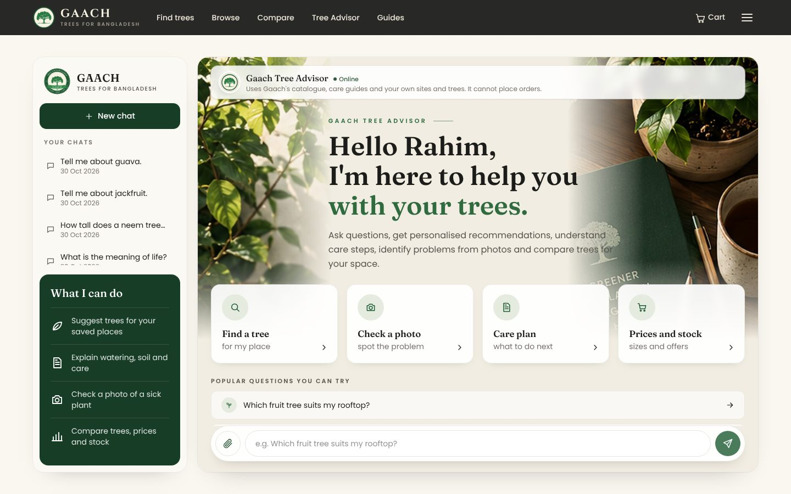
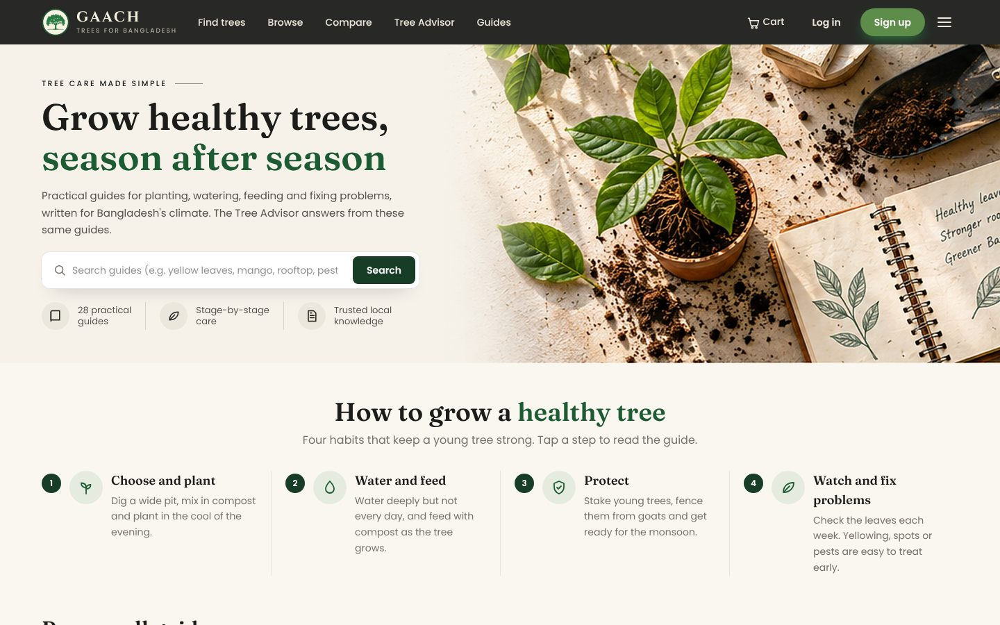
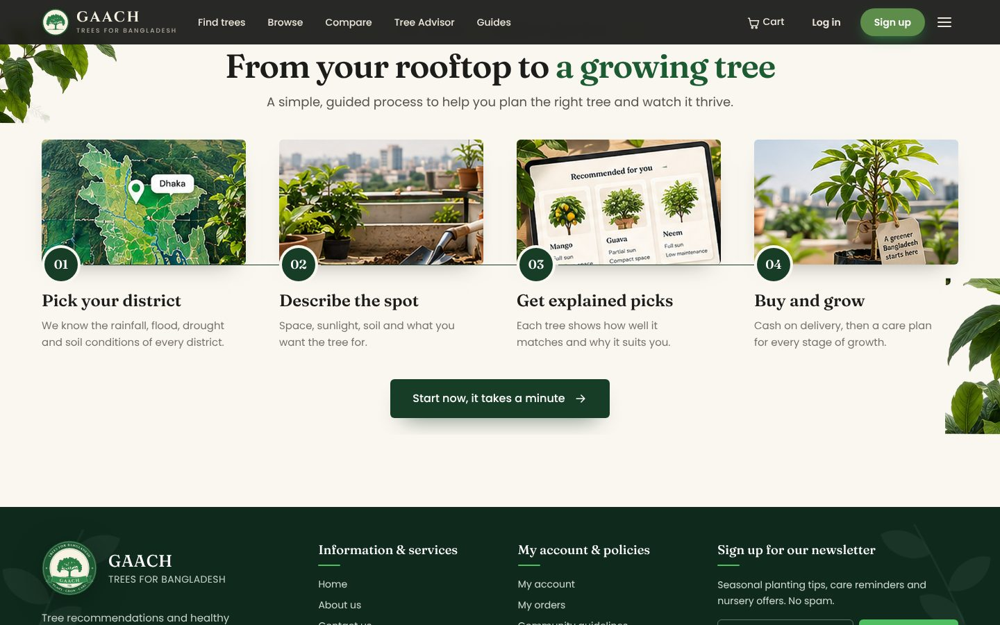
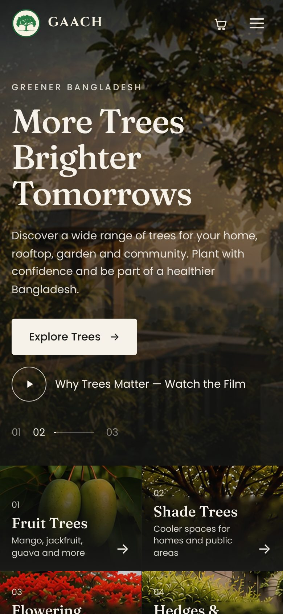
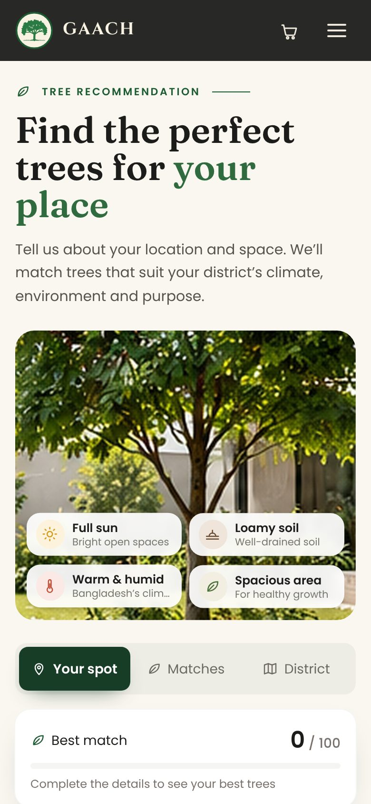
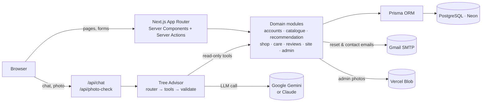

<div align="center">


# Gaach (গাছ)

### The right tree for the right place in Bangladesh

Gaach recommends trees that suit a user's district and planting spot, sells healthy saplings with cash on delivery, and helps after planting with care plans, an AI Tree Advisor and a photo check for sick plants.

**[🌐 Live site: gaach.vercel.app](https://gaach.vercel.app/)**




</div>

---

## Contents

1. [Overview](#overview)
2. [Highlights](#highlights)
3. [Screenshots](#screenshots)
4. [Features](#features)
5. [Pages and routes](#pages-and-routes)
6. [Tech stack](#tech-stack)
7. [Architecture](#architecture)
8. [Data model](#data-model)
9. [Getting started](#getting-started)
10. [Environment variables](#environment-variables)
11. [Email and password reset](#email-and-password-reset)
12. [Admin access](#admin-access)
13. [How the recommendation works](#how-the-recommendation-works)
14. [The Tree Advisor (AI assistant)](#the-tree-advisor-ai-assistant)
15. [Photo check for sick plants](#photo-check-for-sick-plants)
16. [Shop, reviews and accounts](#shop-reviews-and-accounts)
17. [Design system](#design-system)
18. [Responsive layout and accessibility](#responsive-layout-and-accessibility)
19. [Deployment](#deployment)
20. [Project structure](#project-structure)
21. [Scripts](#scripts)
22. [Testing and quality](#testing-and-quality)
23. [Requirement coverage](#requirement-coverage)
24. [Security and privacy](#security-and-privacy)
25. [Troubleshooting](#troubleshooting)
26. [Roadmap](#roadmap)
27. [Credits](#credits)
28. [Author and license](#author-and-license)

---

## Overview

Many saplings planted in Bangladesh die in their first year. Usually the tree didn't suit the place: too much shade, salty soil in the coastal south, land that floods every monsoon, or a large tree squeezed into a rooftop drum.

**Gaach** (Bangla for *tree*) handles the whole journey in three steps:

| Step | What happens |
|---|---|
| **1. Recommend** | The user picks their division and district and describes the spot: space, sunlight, soil and purpose. Gaach matches trees to the district's rainfall, flooding, drought and salinity, and explains every pick. |
| **2. Buy** | The user orders healthy saplings in several sizes, with cash on delivery to all 64 districts. |
| **3. Care** | After buying, the user gets a stage-by-stage care plan, an AI Tree Advisor that knows their own trees and sites, practical care guides, and a photo check for sick plants. |

Gaach was built for **CSE412 (Software Engineering) at East West University, Dhaka**, from a requirements specification of 61 functional and non-functional requirements.

---

## Highlights

- **Explainable recommendations.** Every match shows a score, a match level and a plain-language reason. If nothing fits, Gaach names the condition that ruled out the most trees and suggests how to relax it.
- **A grounded AI advisor.** The Tree Advisor answers only tree questions. It uses nine read-only tools over Gaach's own data, and checks that every price and stock figure in an answer matches the tool results.
- **Built for real shopping.** Stock is reserved in a single database transaction, so two people can't buy the last sapling at the same moment.
- **Polished, responsive design.** A charcoal, warm white and natural green palette, careful entrance animations, and layouts that work from a 360 px phone up to a zoomed-out 4K screen.
- **Free to run.** Vercel Hobby, a Neon free database, the Gemini free tier and Gmail SMTP.

---

## Screenshots

| Find trees for your place | Browse the catalogue |
|---|---|
|  |  |
| **Compare trees side by side** | **Tree Advisor** |
|  |  |
| **Planting and care guides** | **From your rooftop to a growing tree** |
|  |  |

<p align="center">
  
  &nbsp;&nbsp;
  
</p>

---

## Features

### For visitors and customers

| Feature | Description |
|---|---|
| 🌳 **Tree finder** | Recommends trees for a district and spot. Photo cards show the match score, the reasons and Buy and Compare buttons. Condition chips on the page update with the user's choices. |
| 🔎 **Browse and search** | Every tree, with filters for type, sunlight, soil, mature size and price. Search works in English, in Bangla and by scientific name. Grid and list views, sorting and star ratings are included. |
| ⚖️ **Compare** | Put 2 or 3 trees side by side: size, growth rate, sunlight, soil, water, season, flood, drought and salt tolerance, and cautions. Search and quick-add chips make it easy to fill the slots. |
| 🖼️ **Product cards** | Swipe through several photos with arrow buttons, see a SALE badge and the old price crossed out, and add to cart, view details or compare from the card. |
| 🏷️ **Festival sales** | 18 hand-drawn, animated festival styles (Eid, Ramadan, Durga Puja, Diwali, Pohela Boishakh, 21 February, Victory Day, Christmas, Halloween, winter, monsoon and more) for a big sale banner and a top strip with a countdown. An "On sale only" filter lists every discounted tree. |
| 🛒 **Cart and checkout** | Several sizes per tree, quantity steppers, a stock-safe checkout, cash on delivery and a flat delivery fee. |
| 📦 **Orders and My trees** | Order history, plus a "My trees" page that shows each tree's current growth stage and what to do next. |
| 🤖 **Tree Advisor** | An AI chat that answers tree questions using Gaach's data and the user's own trees and saved sites. It is available on every page and as a full page at `/assistant`. |
| 📷 **Photo check** | Send a photo of a sick plant and get the likely problem, safe next steps and links to care guides. |
| 📚 **Care guides** | 28 practical guides grouped into planting and care, pests, problems and diseases, site and weather, safety, and specific trees. All are searchable. |
| ⭐ **Ratings and reviews** | 1 to 5 stars with comments, and a "Bought from Gaach" badge for verified buyers. |
| 🎬 **"Why Trees Matter" film** | A 60-second film with captions, opened from the home page hero. |
| 🔑 **Accounts** | Register, log in, a show/hide eye on every password box, saved sites, and a self-service password reset by email. |
| 📬 **Contact and newsletter** | A contact form and a newsletter sign-up, both protected by a hidden bot trap and rate limits. |
| 📱 **Installable** | Works as a Progressive Web App on phones. |

### For the administrator

| Area | Capabilities |
|---|---|
| **Trees and products** | Add and edit trees and publish them, upload several photos per tree (with reordering), and manage sizes, prices, sale prices, stock and care stages. |
| **Sales and offers** | A Bangladesh festival calendar fills in a sale in one tap. Pick a festival style or upload your own banner picture, then set the name, badge, percent off, the reason shown to shoppers, start and end dates, and all trees or chosen trees. Each sale shows as Live, Scheduled, Ended or Off. |
| **Orders** | View all orders and update their status. Cancelling an order returns its stock. |
| **Users and email** | View accounts, send a test email, email a reset link to a user, and see the last emails the site tried to send, with the result of each. |
| **Reviews** | Hide, show or delete reviews. |
| **Site info and messages** | Edit the hotline, nursery addresses, email and social links shown in the footer. Read contact messages and newsletter sign-ups. |
| **Regions and delivery** | Edit regional climate profiles, assign districts to regions, and set the delivery fee. |
| **Care guides** | Review guides and mark them as checked. |
| **AI status and review** | Test the AI connection, and see refused questions with their reasons, plus tool usage. |

---

## Pages and routes

| Page | Route |
|---|---|
| Home | `/` |
| Find trees for my place | `/recommend` |
| Browse all trees | `/trees` |
| Tree details, sizes and reviews | `/trees/[slug]` |
| Compare | `/compare` |
| Tree Advisor | `/assistant` (plus a chat button on every page) |
| Care guides, one guide | `/guides`, `/guides/[slug]` |
| Cart, checkout | `/cart`, `/checkout` |
| My orders, My trees | `/orders`, `/my-trees` |
| Account and saved sites | `/account` |
| Log in, register, forgot and reset password | `/login`, `/register`, `/forgot-password`, `/reset-password` |
| About, contact | `/about`, `/contact` |
| Policies | `/privacy`, `/terms`, `/refund-policy`, `/community-guidelines` |
| Photo credits | `/credits` |
| Admin dashboard | `/admin` |
| API | `/api/chat`, `/api/photo-check` |

---

## Tech stack

| Layer | Technology |
|---|---|
| Framework | **Next.js 15** (App Router, Server Components, Server Actions) |
| Language | **TypeScript** (strict) |
| UI | **React 19**, **Tailwind CSS 4**, hand-written CSS animations |
| Database | **PostgreSQL** (Neon, free tier) |
| ORM | **Prisma 6** |
| Validation | **Zod** on every form and API input |
| Authentication | Email and password, **bcrypt** hashing, database sessions with an idle timeout |
| AI | **Google Gemini** (free tier, with automatic model fallback); **Claude** (Anthropic) also supported |
| Email | **Nodemailer** through Gmail SMTP |
| File storage | **Vercel Blob** online, a local `uploads/` folder in development |
| Hosting | **Vercel** (Hobby plan, Singapore region) |
| Testing | Node's built-in test runner (`node:test`) with `tsx`, and Playwright for browser checks |

---

## Architecture



- **Pages** are Server Components that read data directly through Prisma. **Mutations** (cart, checkout, reviews, admin edits) are Server Actions that validate input with Zod and check the user's role on the server.
- **Business logic** lives in `src/modules/*`, separate from the UI, so it can be unit-tested and reused, for example by the Advisor's tools.
- **The Tree Advisor** never writes data. Its tools are read-only, and the user's identity always comes from the session, never from the chat message.

---

## Data model

The Prisma schema (`prisma/schema.prisma`) has 25 models, in six groups:

| Group | Models |
|---|---|
| Accounts | `User`, `Session`, `PasswordReset`, `Site` (saved planting spots) |
| Geography and climate | `Division`, `District`, `Region` (rainfall, flood, drought and salinity profile) |
| Catalogue and care | `Tree`, `TreePhoto` (extra photos), `Product` (sizes, prices, sale prices, stock), `CareStage`, `CareGuide` |
| Shop | `CartItem`, `Order`, `OrderItem`, `OwnedTree` (a bought tree with its planted date), `Promotion` (occasion sales) |
| Community | `Review`, `Subscriber`, `ContactMessage` |
| Advisor and operations | `Conversation`, `ChatMessage`, `RefusedQuestion`, `EmailLog`, `Setting` |

The starting data in `prisma/data/` covers 30 tree species, all 8 divisions and 64 districts mapped to regional climate profiles, the care stages for each tree, and the care guides.

---

## Getting started

### Prerequisites

- **Node.js 20 or newer** (check with `node -v`)
- A **PostgreSQL** database. The easiest free option is [Neon](https://neon.tech). A local PostgreSQL works too.

### Install and run

```bash
# 1. Clone and install
git clone https://github.com/mohammednaeemog-sys/gaach.git
cd gaach
npm install

# 2. Create your settings file
cp .env.example .env        # Windows PowerShell: Copy-Item .env.example .env
#    then open .env and set DATABASE_URL

# 3. Create the tables and load trees, districts and guides
npm run setup

# 4. Start the development server
npm run dev
```

Open **http://localhost:3000**.

`npm run setup` is safe to repeat and never deletes data. To wipe the database and start again, use `npm run db:reset`.

### Demo account (local development)

| Role | Email | Password |
|---|---|---|
| User | `user@gaach.test` | `User1234` |

The demo user has two saved sites and a delivered lemon tree, so "My trees" and personal Advisor questions work straight away. Locally, if `ADMIN_EMAIL` is not set, a demo admin is created for testing. Online, the demo admin is always locked (see [Admin access](#admin-access)).

---

## Environment variables

Copy `.env.example` to `.env`. **Never commit `.env`**; it is already listed in `.gitignore`.

| Variable | Needed | Purpose |
|---|---|---|
| `DATABASE_URL` | ✅ Always | PostgreSQL connection string (`postgresql://...`). |
| `ADMIN_EMAIL` | Online | Email address of the owner's admin account. |
| `ADMIN_PASSWORD` | Online | Password for that admin account. |
| `GEMINI_API_KEY` | Optional | Turns on the AI Tree Advisor and photo check. Free at [aistudio.google.com/apikey](https://aistudio.google.com/apikey). |
| `GEMINI_MODEL` | Optional | Forces one Gemini model instead of the automatic fallback list. |
| `ANTHROPIC_API_KEY` | Optional | Uses Claude instead of Gemini (paid). |
| `AI_PROVIDER` | Optional | `gemini` or `claude`, when both keys are set. |
| `SMTP_USER` | Optional | Gmail address that sends reset and contact emails. Gaach uses `gaach.company@gmail.com`. |
| `SMTP_PASS` | Optional | The 16-letter Gmail **App password**, never the account password. |
| `SMTP_HOST`, `SMTP_PORT` | Optional | Another SMTP server. Defaults to Gmail on port 465, with 587 as a fallback. |
| `MAIL_FROM` | Optional | Sender name and address, e.g. `Gaach <gaach.company@gmail.com>`. Defaults to `Gaach <SMTP_USER>`. |
| `APP_URL` | Optional | The public site address used in email links. |
| `BLOB_READ_WRITE_TOKEN` | Online | Added by Vercel when a Blob store is connected; stores admin photo uploads. |

Without a Gemini key, the site still works: the Advisor answers from Gaach's own data. Without email settings, the forgot-password page explains that email isn't available, and reset links are printed in the server log.

---

## Email and password reset

When someone uses **Forgot password**, Gaach emails them a one-time reset link straight away. The link expires after 30 minutes, and a user can request at most 3 links per hour. Resetting the password signs the user out on every device.

**Setting up Gmail (free):**

1. Turn on **2-Step Verification** for the Google account that will send the emails.
2. Create an **App password** at [myaccount.google.com/apppasswords](https://myaccount.google.com/apppasswords).
3. In Vercel → Settings → Environment Variables, set `SMTP_USER` to the Gmail address and `SMTP_PASS` to the App password. Mark both as secret.
4. Redeploy. Vercel only applies new variables to new deployments.

Every attempt is logged. **Admin → Users → Recent emails** shows each message's recipient, time and result, including the error if Gmail refused it.

---

## Admin access

The admin login is **never stored in the code or the repository**. It is set privately through the `ADMIN_EMAIL` and `ADMIN_PASSWORD` environment variables.

On every build, `scripts/seed-if-empty.ts`:

1. creates the admin account from those variables if it doesn't exist, or makes sure it is an admin with that password;
2. locks the public demo admin (`admin@gaach.test`) by turning it into a normal user with a random password.

To change the admin password, edit `ADMIN_PASSWORD` in Vercel and redeploy.

---

## How the recommendation works

Code: `src/modules/recommendation/`

1. **Region.** The district maps to a regional profile: rainfall, flooding, drought and salty soil. Admins can edit these profiles.
2. **Filter.** Trees are removed if they can't survive the region, are wider than the space available, or don't tolerate the sunlight.
3. **Score.** The remaining trees are scored on soil, purpose, regional strengths, room to spare and preferred sunlight. The weights are in `weights.ts`, so they're easy to tune.
4. **Explain.** Each result gets a match level and a plain-language reason. If nothing qualifies, the page names the condition that removed the most trees and suggests how to relax it.

Ties are broken by name and id, so the same inputs always give the same ranking.

---

## The Tree Advisor (AI assistant)

Code: `src/modules/assistant/`

The Advisor is the round button in the bottom-right corner of every page. The full chat with history is at `/assistant`. On a tree page, it already knows which tree you mean.

It answers **tree questions only**: why a tree was recommended, planting and care, plant problems, comparisons, products, and help with the trees the user bought. It never places orders, changes accounts or invents trees.

**How an answer is made:**

1. `router.ts` sorts the question by intent and refuses off-topic, manipulative or privacy-breaking questions **before** any AI call.
2. `tools.ts` gives the AI nine **read-only** tools: catalogue search, tree details, recommendations, compare, product price and stock, the user's saved sites, the user's trees, care plans, and guide search. The user always comes from the login session, never from the question.
3. `retrieval.ts` searches the care guides (English and Bangla word matching). Answers show their sources as "Based on" chips.
4. For plant problems, it asks one question at a time before suggesting causes.
5. `validate.ts` checks every answer. Prices and stock must match this turn's tool results, or the AI is asked to correct itself.

**Reliability.** Free Gemini models are sometimes busy. The site tries `gemini-3.5-flash`, then `gemini-3.8-flash`, then `gemini-3.5-flash-lite`, skips any model that was busy in the last 3 minutes, and after 50 seconds answers from Gaach's own data instead. **Admin → AI status & review** shows the exact problem if the AI isn't working.

---

## Photo check for sick plants

Code: `src/modules/assistant/photo.ts`, `src/app/api/photo-check/route.ts`

In the Advisor chat, the 📷 button lets a user send a photo, with an optional note such as "lemon, leaves yellowing". The reply gives:

- the most likely problem and how sure it is,
- other possibilities,
- safe next steps and things to avoid,
- links to Gaach's own care guides.

Blurry photos get a request for a better photo instead of a guess. The photo is shrunk in the browser before upload and is **never stored**; only the text answer is saved. Users are limited to 5 checks per minute.

---

## Shop, reviews and accounts

- **Checkout.** Stock is checked and reduced in a single database transaction, so two people can't buy the last sapling at once. Payment is cash on delivery. A test-mode online gateway is included for demonstration.
- **Discounts.** A size can have a fixed sale price, and an occasion sale can take a percentage off all trees or chosen ones. The customer always gets the lowest price, and the cart, checkout, order record and Tree Advisor all use the same pricing rules (`src/modules/shop/price-rules.ts`).
- **Delivery.** One flat fee for all 64 districts, set by the admin.
- **Reviews.** One review per user per tree. Verified buyers get a "Bought from Gaach" badge. Admins can hide reviews that break the community guidelines.
- **Accounts.** Passwords are hashed with bcrypt. Sessions are stored in the database and expire when idle. A reset needs the one-time link sent to the account's inbox, and the owner gets a "password changed" email afterwards. Every password box has a show/hide eye button.
- **Footer details.** The hotline, nursery addresses, email and social links are edited in **Admin → Site info & messages**. Empty fields are hidden, so no placeholder contact details ever appear.

---

## Design system

| Token | Value | Use |
|---|---|---|
| Charcoal | `#1c1d1a` | Header, hero overlays, primary text |
| Warm white | `#f6f2ea` | Page background, text on dark |
| Natural green | `#5e8c4a` | Accents and highlights |
| Deep green | `#183d27` | Primary buttons, active tabs, step numbers |
| Footer green | `#0f2a1d` | Footer background |

- **Type.** Fraunces for headings, Poppins for body text, Cinzel for the wordmark, and Noto Serif Bengali for Bangla names.
- **Photography.** Real tree photos on cards. The page heroes (garden, map of Bangladesh, balance board, advisor desk and planting table) were prepared from the approved design mockups.
- **Motion.** Headlines rise in line by line, hero photos settle with a slow zoom, condition chips and labels pop in and drift gently, step numbers pop and connecting lines draw across, and cards lift on hover. The home hero cross-fades between three photos every 4 seconds, with a progress line under 01 · 02 · 03.
- **Restraint.** Every animation is turned off for people who set "reduce motion" in their system settings.

---

## Responsive layout and accessibility

- **Mobile first.** Layouts are checked at 360, 390, 768, 1024, 1100, 1280, 1440 and 1920 px wide, with no sideways scrolling on any page.
- **Wide and zoomed-out screens.** From 1536 px up, the root font size grows with the screen width (`font-size: calc(100vw / 96)`), and every size in the interface is set in `rem`. The whole layout scales together, so it fills a 4K monitor or a browser zoomed out to 25%.
- **Accessibility.** The HTML is semantic, every form field has a label, and focus states are visible. The film has captions, the carousel pauses on hover, and live regions announce Advisor replies. Images have alt text, and decorative images are hidden from screen readers.

---

## Deployment

The live site runs on **Vercel** (free Hobby plan) with a **Neon** PostgreSQL database and **Vercel Blob** for photos. The full step-by-step guide is in **[DEPLOY.md](DEPLOY.md)**.

1. Create a Vercel project and link it: `npx vercel@latest link`.
2. In Vercel → Storage, connect a **Neon** database (prefix `DATABASE`) and a **public Blob store**.
3. Add `ADMIN_EMAIL`, `ADMIN_PASSWORD`, `GEMINI_API_KEY`, `SMTP_USER` and `SMTP_PASS` as environment variables.
4. Deploy with `npx vercel@latest --prod`, or connect this GitHub repository so every push deploys automatically.

The build command (`npm run build`) syncs the database schema, loads starting data into an empty database, sets up the admin account, and then builds the site. It never overwrites existing data.

---

## Project structure

```
gaach/
├── prisma/
│   ├── schema.prisma          database tables
│   ├── seed.ts                starting data
│   └── data/                  trees, districts and regions, care stages, care guides
├── public/                    logo, photos, icons
├── scripts/
│   ├── seed-if-empty.ts       runs on every build: first-time data and admin setup
│   ├── eval-assistant.ts      Tree Advisor evaluation
│   ├── fetch-tree-photos.ts   downloads openly licensed tree photos
│   └── make-logo.mjs          draws the logo
├── src/
│   ├── app/                   pages and API routes (Next.js App Router)
│   ├── components/            UI components (Header, Footer, Chat, TreeCard, forms...)
│   ├── lib/                   database client, email, formatting, helpers
│   └── modules/
│       ├── accounts/          register, login, sessions, profile, password reset
│       ├── catalogue/         browse, search, filters, compare
│       ├── recommendation/    matching engine and weights
│       ├── shop/              cart, checkout, orders, payment
│       ├── care/              care stages and planted dates
│       ├── assistant/         Tree Advisor, AI providers, tools, photo check
│       ├── reviews/           ratings and comments
│       ├── site/              footer details, contact form, newsletter
│       └── admin/             admin actions and uploads
├── tests/                     unit tests
├── docs/                      screenshots and the film notes
├── DEPLOY.md                  free hosting guide
└── vercel.json                Vercel settings (Next.js, Singapore region)
```

---

## Scripts

| Command | Description |
|---|---|
| `npm run dev` | Start the development server at http://localhost:3000 |
| `npm run setup` | Create the tables and fill an empty database (safe to repeat) |
| `npm run build` | Sync the database, set up first-time data and the admin, then build |
| `npm start` | Run the production build |
| `npm test` | Run the unit tests |
| `npm run typecheck` | Check TypeScript types |
| `npm run eval` | Run the Tree Advisor evaluation (add `-- --ai` to use the live AI) |
| `npm run db:reset` | ⚠️ Delete everything and reload the starting data |
| `npm run photos` | Download openly licensed tree photos from Wikimedia Commons |
| `npm run logo` | Redraw the logo files |

---

## Testing and quality

- **Unit tests** (`npm test`): 44 tests covering the recommendation engine, care stages, password hashing, reset tokens, the Advisor's routing and AI fallback, and photo-check parsing.
- **Advisor evaluation** (`npm run eval`): 140 scripted conversations covering catalogue questions, recommendations, care, multi-turn chats, personal questions, missing information, off-topic requests and safety cases, plus 30 guide-search checks. Offline result: 140/140 and 30/30. The report is written to `evals/REPORT-offline.md`.
- **Browser checks.** Playwright scripts test the cart, checkout, reviews, photo check, login (including the password eye), and the contact and newsletter forms. They also check every main page for horizontal overflow at 8 screen widths.
- **Type safety.** `npm run typecheck` passes with no errors.

---

## Requirement coverage

| Area | Where |
|---|---|
| FR-1 Accounts and access | `/register`, `/login`, `/account`, `/forgot-password`; role checks in `modules/accounts/session.ts` |
| FR-2 Location and conditions | `/recommend` form (division and district dropdowns, validated inputs), saved sites |
| FR-3 Recommendation | `modules/recommendation`, reasons, no-match advice, refine via URL |
| FR-4 Information and comparison | `/trees`, `/trees/[slug]`, `/compare` |
| FR-5 E-commerce | `/cart`, `/checkout`, `/orders`; cash on delivery and test gateway; stock-safe transaction |
| FR-6 Post-purchase care | `/my-trees` with current stage and full plan; problem help through the Advisor |
| FR-7 AI assistant | `/assistant`, `modules/assistant`; fixed refusals, personal context, grounded answers, memory |
| FR-8 Administration | `/admin`: trees, products, care content, regions, delivery fee, orders, users, reviews, site info, AI review |

---

## Security and privacy

- No passwords, API keys or private credentials are stored in the repository. All secrets live in environment variables, marked as secret in Vercel.
- Passwords are hashed with bcrypt. Reset tokens are stored only as SHA-256 hashes, expire after 30 minutes, and are limited to 3 per hour.
- Every admin page and action checks the admin role on the server.
- All input is validated on the server with Zod. The contact and newsletter forms have a hidden bot trap and rate limits.
- Plant photos sent for a check are never stored.
- Redirects only go to paths on this site.

---

## Troubleshooting

| Problem | Fix |
|---|---|
| `P1001: Can't reach database server` | Check `DATABASE_URL`. Locally, make sure PostgreSQL is running. |
| Reset emails don't arrive | Use a Gmail **App password** (not the account password) in `SMTP_PASS`, redeploy, then check **Admin → Users → Recent emails** for the exact error. |
| The Advisor answers without AI | Set `GEMINI_API_KEY`. **Admin → AI status & review** shows whether the key works and which model answered. |
| New environment variables have no effect | Redeploy. Vercel applies variables only to new deployments. |
| `git commit` opens a Vim screen | Press `Esc`, type `:q!` and press Enter, then commit with `git commit -m "your message"`. To use Notepad instead, run `git config --global core.editor notepad`. |

---

## Roadmap

- Expert review of every care guide.
- Bangla interface and Bangla offline Advisor answers.
- Real online payments (bKash, Nagad or SSLCommerz) in place of the test gateway.
- Order tracking with courier updates.
- Native Android and iOS apps (Capacitor or Expo) that reuse the same server.

---

## Credits

- Tree photos are credited on the [photo credits](https://gaach.vercel.app/credits) page under their open licenses.
- The "Why Trees Matter" film uses royalty-free footage from Pixabay; the notes are in [`docs/why-trees-matter-film.md`](docs/why-trees-matter-film.md).
- Fonts (Fraunces, Poppins, Cinzel, Noto Serif Bengali) are used under the SIL Open Font License.

---

## Author and license

**Mohammed Naeem**
Computer Science and Engineering, East West University, Dhaka
Designer, developer and administrator of Gaach

- GitHub: [@mohammednaeemog-sys](https://github.com/mohammednaeemog-sys)
- Email: [mohammed.naeem.og@gmail.com](mailto:mohammed.naeem.og@gmail.com)
- Live site: [gaach.vercel.app](https://gaach.vercel.app/)

This repository does not include an open-source license yet, so all rights are reserved by the author. Please get in touch before reusing the code or content.

<div align="center">

🌱 *Plant the right tree in the right place.*

</div>
